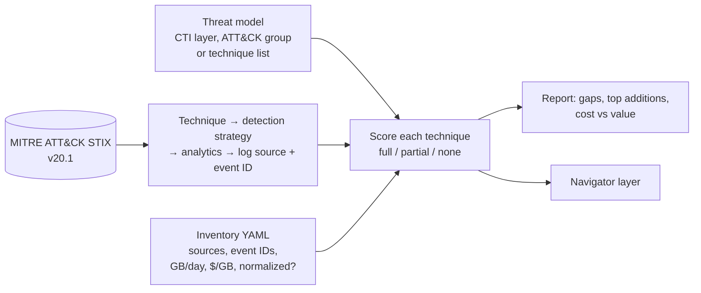

# Telemetry Coverage Analyzer


**Which attacks can we actually detect with the logs we pay for?** This tool answers that from data, not opinion. It reads the official MITRE ATT&CK release (v18+ detection model), resolves every technique in a threat model to the **log sources and event IDs** its analytics need, compares them to your log-source inventory, and reports:

1. **Coverage:** full, partial or blind spot for each technique in the threat model.
2. **Exact gaps:** which source and event ID is missing (for example `WinEventLog:Security EventCode=4662` for DCSync).
3. **Highest-value additions:** the missing signals that move the most techniques toward full coverage.
4. **Cost versus value:** monthly cost per source, techniques it enables, techniques it is the *only* coverage for, and cost per covered technique.
5. **A Navigator layer** colored by coverage for briefings.

## How it works



An analytic counts as **full** only when every signal it references is collected; **partial** when some are; the technique takes the best analytic for the platforms in scope.

## Results on the example inventory

Example inventory: a mid-size defense contractor collecting Windows Security (no 4662/5136 auditing), Sysmon 1/3/11/13 only, PowerShell 4104, CloudTrail, M365, Entra ID, Okta and firewall logs. Volumes and prices are **illustrative planning assumptions** labeled as such in [`examples/inventory.yml`](examples/inventory.yml).

| Threat model | Techniques | Full | Partial | Blind spots |
| --- | --- | --- | --- | --- |
| [SafePay ransomware](reports/safepay-ransomware.md) (from my [CTI brief](https://github.com/mk7git-hub/cti-threat-briefs)) | 29 | 12 (41%) | 16 (55%) | 1 (DCSync) |
| [Integrity Tech espionage](reports/integrity-tech-espionage.md) (CISA AA26-281A) | 15 | 3 | 9 | 1 |
| [Volt Typhoon](reports/volt-typhoon.md) (ATT&CK group, 81 techniques) | 81 | 24 | 38 | 0 (19 have no in-scope guidance) |

What the SafePay report tells a SOC lead in one minute:

- **DCSync is invisible**: Windows 4662 is not audited. Turning on Directory Service Access auditing closes it.
- **Sysmon event 7 (image load) and 10 (process access)** would improve 6 and 4 SafePay techniques respectively (LSASS dumping, UAC bypass, PowerShell, LOLBins).
- **The firewall feed costs $9,000/month and contributes to none of these techniques**, while CloudTrail at $600 is the only coverage for three. That is a budget conversation: sample or tier the firewall data, fund Sysmon 7/10.

## Run it

```bash
pip install -r requirements.txt
python -m tca.cli --inventory examples/inventory.yml --layer examples/safepay-layer.json --title "SafePay ransomware"
python -m tca.cli --inventory examples/inventory.yml --group "Volt Typhoon" --title "Volt Typhoon"
python -m tca.cli --inventory my-inventory.yml --techniques T1003.006,T1490,T1567.002 --title "Board top 3"
```

The first run downloads the current ATT&CK STIX bundle into `data/`. Reports land in `reports/` as Markdown plus a Navigator layer JSON.

### Inventory format

```yaml
platforms: [Windows, IaaS]          # limits analytics to the platforms you run
sources:
  - name: WinEventLog:Security      # ATT&CK log-source name
    channels: ["4624", "4688"]      # event IDs you collect, or "*" for everything
    daily_gb: 40
    cost_per_gb: 2.5
    normalized: true                # mapped to a common schema (CIM/ECS/ASIM)?
```

## Design decisions

- **Use ATT&CK's own detection model** (detection strategies, analytics, log-source references) instead of a hand-made mapping, so results update with every ATT&CK release; CI re-runs weekly.
- **Event-ID precision.** "We collect Windows Security" means nothing if 4662 is not audited; the inventory records event IDs.
- **Partial is reported, not hidden.** Most real coverage is partial; the missing signal list is the work plan.
- **Cost per technique** frames log engineering as a business decision, which is how log budgets get approved or cut.

## Tests

`pytest` runs 7 unit tests against a small synthetic ATT&CK bundle (blind spot, partial, full, source value, recommendations, group aliases, platform filter). Lint with ruff.

## Limitations

- Coverage means *the data exists to build a detection*, not that a detection is deployed and tested. Pair with [detection-as-code-pipeline](https://github.com/mk7git-hub/detection-as-code-pipeline) and a validation lab for that.
- Free-text channels in ATT&CK (for example "VPN gateway logs") match only when the source is collected with `channels: "*"`.

ATT&CK® is a registered trademark of The MITRE Corporation; data © MITRE, used under the ATT&CK terms of use.
